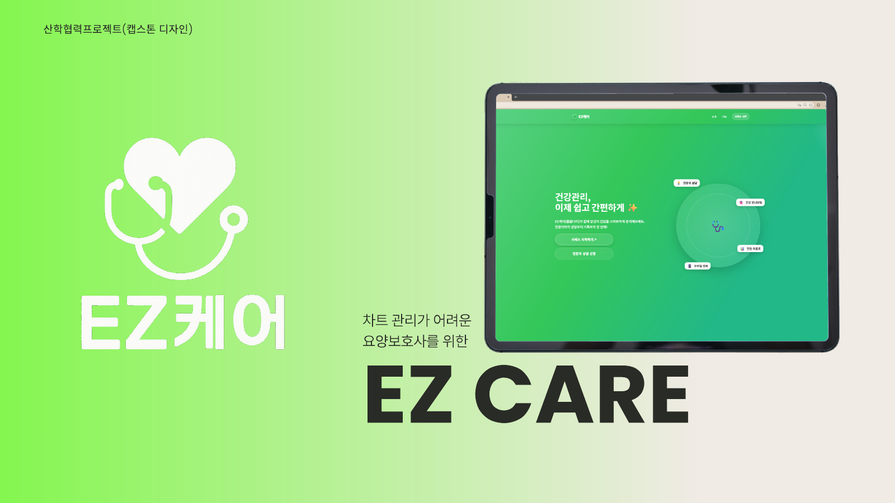
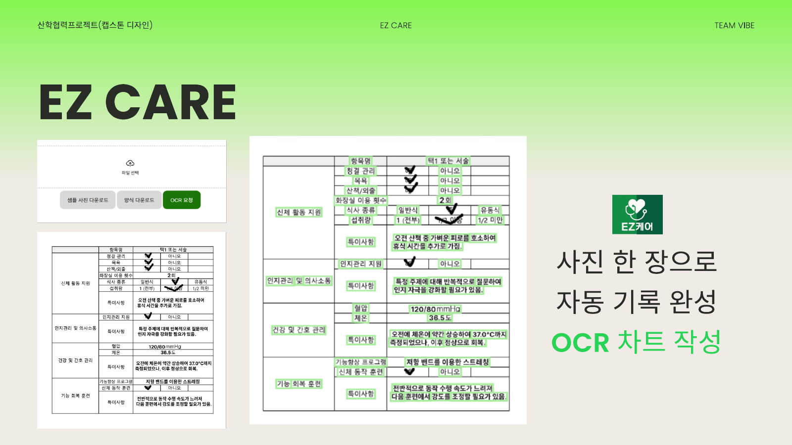
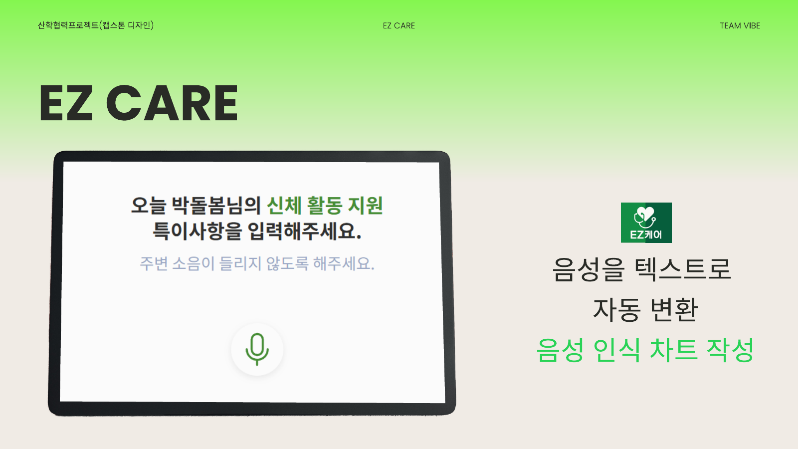
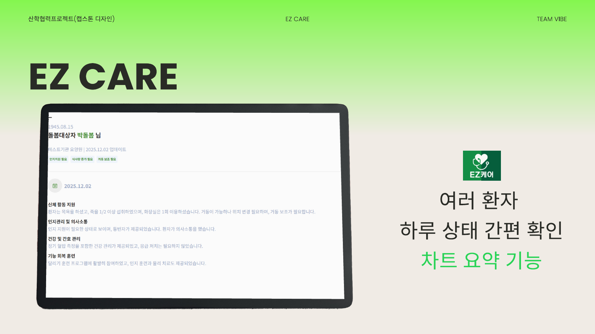
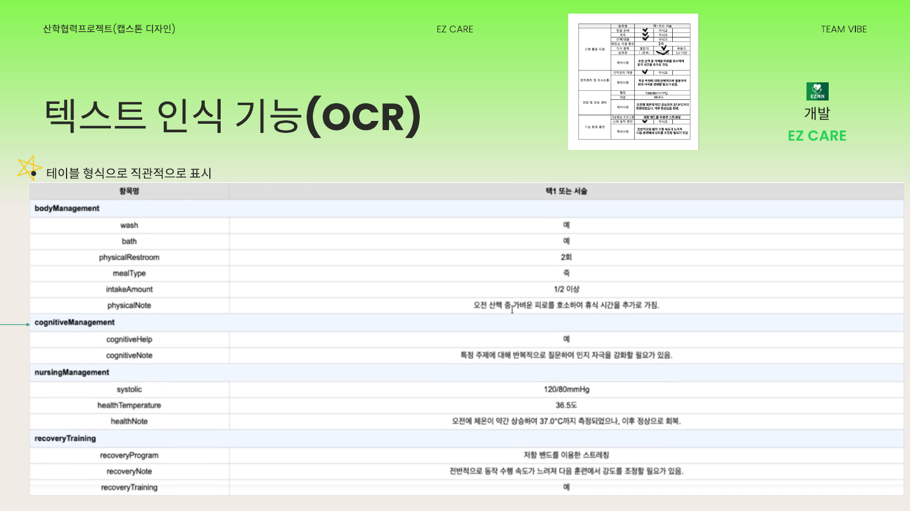
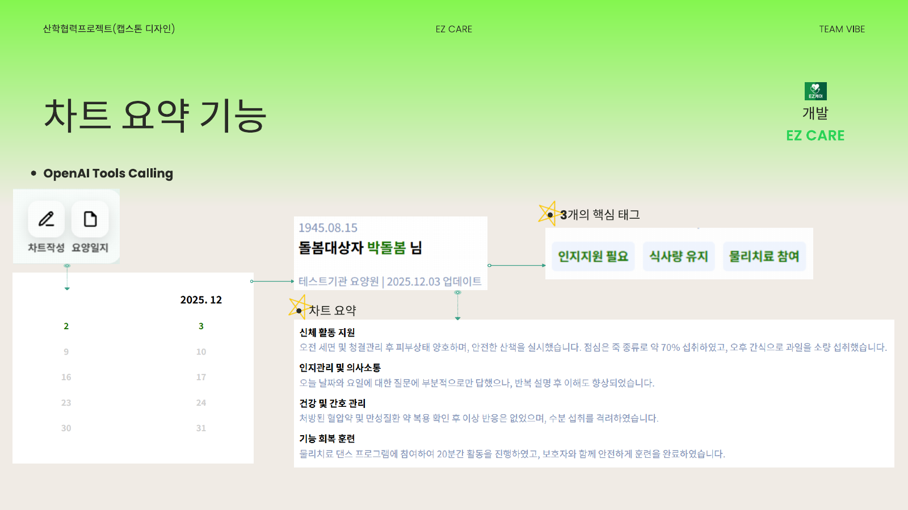
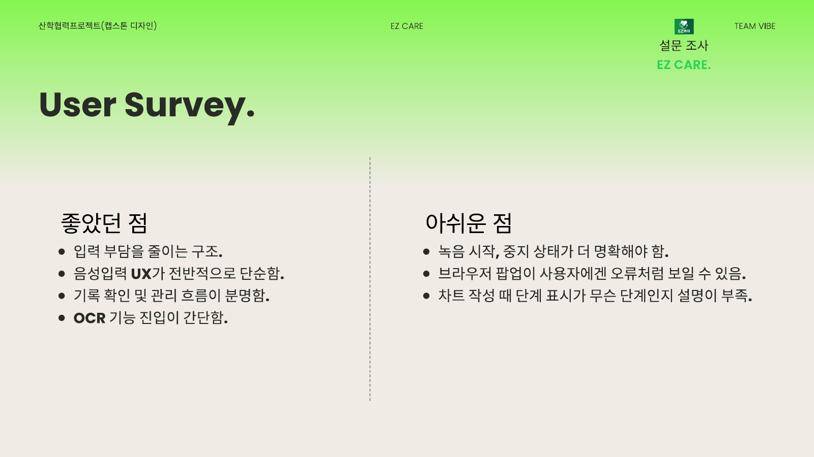
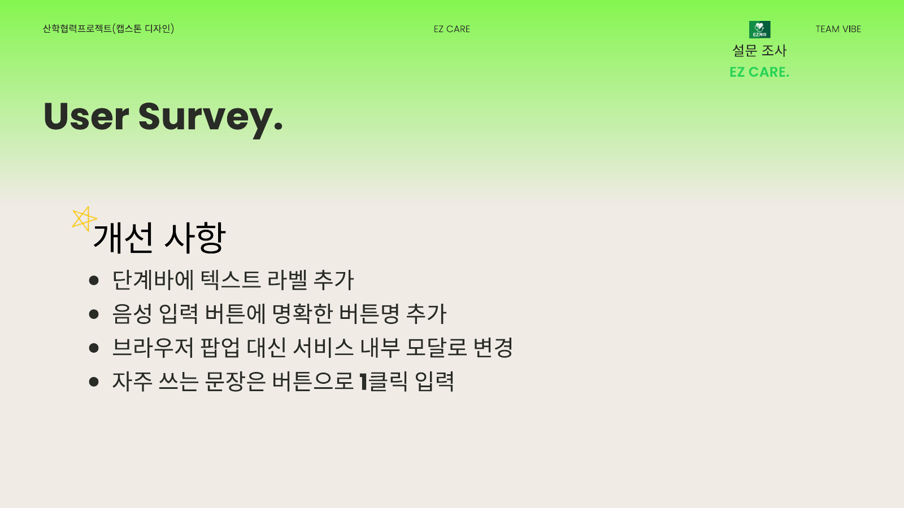

# EZ Care 회고

고령의 요양보호사가 돌봄 차트를 쉽게 작성할 수 있도록 돕는 웹 서비스 「EZ 케어」를 만든 팀 프로젝트를 정리한 저장소입니다. 코드는 없고, 프로젝트가 왜 시작됐고 무엇을 만들었는지, 현장에서 무엇을 배웠는지, 그리고 제가 맡은 일을 정리했습니다.

- 기간: 2025년 9월 ~ 12월
- 수업: 캡스톤디자인 (자율 주제), 6인 팀 (Team VIBE)
- 최종 발표 자료: [final-presentation.pdf](docs/final-presentation.pdf) (제가 만들고 발표한 자료. 팀원 이름과 현장 사진은 가렸습니다)
- 팀 프론트엔드 저장소: [CapCap](https://github.com/DANIELSUNWOO/CapCap)

## 왜 만들었나

요양보호사의 평균 연령은 61.7세이고, 60대 이상이 62.3%입니다(2023년 기준). 그런데 요양원에서 쓰는 관리 시스템은 기능이 많고 복잡해서, 현장에서는 여전히 종이에 적고 나중에 다시 옮겨 적는 경우가 많습니다. 기록이 빠지거나, 같은 내용을 두 번 쓰거나, 근무자끼리 인수인계가 어려워지는 문제가 생깁니다.

그래서 디지털 기기에 익숙하지 않은 요양보호사도 쓸 수 있도록, 입력을 최대한 줄인 차트 작성 서비스를 만들기로 했습니다.

## 무엇을 만들었나

차트는 세 가지 방법으로 작성할 수 있습니다.

| 방법 | 내용 |
|---|---|
| 사진 (OCR) | 종이 차트를 찍어 올리면 항목과 값을 인식해 자동으로 채움 |
| 말 (STT) | 특이사항을 말하면 글로 바꿔 줌. 결과는 직접 고칠 수 있음 |
| 직접 입력 | 단계별로 입력. 한 단계를 마쳐야 다음으로 넘어가게 해서 빠뜨리지 않게 함 |

작성된 차트는 AI가 요약하고 핵심 태그(예: 인지 지원 필요, 식사량 유지)를 붙여서, 여러 어르신의 상태를 짧은 시간에 확인할 수 있게 했습니다. 화면 확대·축소 버튼, 날짜별 요양 일지, 관리자 승인 방식의 가입도 넣었습니다.

| OCR 차트 작성 | 음성 인식 차트 작성 | 차트 요약 |
|---|---|---|
|  |  |  |

## OCR 엔진은 직접 비교해서 골랐다

요양 일지는 표 형식이라, 글자를 읽는 것보다 "어떤 항목에 어떤 값이 들어갔는지"가 그대로 남는지가 더 중요했습니다. 그래서 OCR 몇 가지를 직접 호출해 같은 일지 사진으로 비교했습니다.

- Tesseract는 표의 열을 인식하지 못하고 "항목명", "청결 관리" 같은 글자를 세로로 읽어 버렸습니다.
- EasyOCR은 글자는 빠짐없이 읽었지만 표 구조를 무시하고 긴 문단 하나로 돌려줘서, 항목과 값을 다시 짝지으려면 후처리가 많이 필요했습니다.
- Naver Clova OCR은 "청결 관리: 아니오"처럼 항목과 값을 짝지은 형태로 돌려줬습니다.

인식률만 보면 비슷해 보여도, 결과를 바로 차트에 넣을 수 있는지는 크게 달랐습니다. 그래서 Clova OCR을 골랐습니다.

## 그 밖에 정한 것들

**음성 인식은 브라우저 기능으로.** 유료 API 대신 브라우저에 내장된 Web Speech API를 써서 비용을 들이지 않았습니다.

**요약은 출력 형식을 강제.** LLM에게 그냥 요약을 부탁하면 "네, 요약해 드리겠습니다" 같은 문장이나 차트에 없는 내용이 섞여서 저장할 때 오류가 났습니다. OpenAI의 Tool Calling으로 "요약문"과 "핵심 태그"만 채워서 돌려주게 해서 해결했습니다.

## 현장 검증

요양원에 직접 가서 종사자분들께 서비스를 써 보시게 하고 설문과 인터뷰를 했습니다.

- 좋았던 점: 사진과 음성으로 입력할 수 있어 글쓰기 부담이 줄었고, 요약이 항목별로 정리돼서 인수인계할 때 도움이 된다는 반응
- 아쉬웠던 점: 녹음이 시작됐는지 잘 안 보이고, 브라우저 팝업이 오류처럼 보이고, 지금 몇 번째 단계인지 설명이 부족함
- 반영할 것: 단계 표시에 글자 추가, 녹음 버튼을 더 분명하게, 브라우저 팝업 대신 서비스 안의 안내창, 자주 쓰는 문장은 버튼 한 번으로 입력

| 반응 | 개선 사항 |
|---|---|
|  |  |

저희가 공들인 OCR이나 음성 입력보다, 글자 크기와 버튼처럼 생각지 못한 부분에서 더 많은 지적을 받았습니다. 만드는 사람이 중요하다고 생각한 것과 현장이 필요로 하는 것이 다를 수 있다는 걸 이때 알았습니다.

## 제가 맡은 일

조장을 맡아 주제를 제안하고 발표를 하면서, 개발에서는 인공지능 기능과 프론트엔드의 관리자 페이지를 맡았습니다.

- 주제 제안: 요양보호사의 차트 작성을 AI로 돕자는 주제를 냈습니다.
- 조장과 발표: 팀을 이끌었고, 발표 자료를 만들어 직접 발표했습니다.
- 인공지능: AI 기능을 맡았고, 위의 OCR들을 직접 호출해 비교해서 Clova OCR을 골랐습니다.
- 프론트엔드: 가입을 승인하고 요양보호사와 돌봄 대상자 목록을 관리하는 관리자 페이지를 만들었습니다.

개발 경험이 많지 않을 때 시작한 프로젝트라 아이디어와 팀 운영에 더 많은 힘을 썼는데, 하면서 화면 뒤의 서버와 데이터를 직접 다룰 수 있어야 서비스를 끝까지 책임질 수 있겠다고 생각했습니다. 그래서 끝난 뒤 백엔드 공부를 시작했습니다. 이후 Spring Boot로 [prep2gether](https://github.com/DANIELSUNWOO/prep2gether)의 전문가 상담·정기결제와 [MoneyLog](https://github.com/DANIELSUNWOO/moneylog)를 만들었습니다.

## 기술

- 프론트엔드: React, TypeScript, Vite
- 백엔드: Spring Boot, JWT 인증
- AI: Naver Clova OCR, Web Speech API (STT), OpenAI API (Tool Calling)
